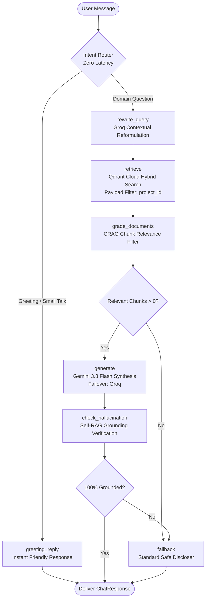

# Multi Tenant RAG

[](https://python.org)
[](https://fastapi.tiangolo.com)
[](https://langchain-ai.github.io/langgraph/)
[](https://qdrant.tech)
[](https://ai.google.dev/)
[](https://groq.com)
[](https://opensource.org/licenses/MIT)

A production-ready, ultra-lightweight, **Multi-Tenant Retrieval-Augmented Generation (RAG)** platform and embeddable chat widget. Powered by **FastAPI**, **LangGraph**, **Qdrant Cloud**, **Google Gemini**, and **Groq**.

Engineered specifically to run efficiently in resource-constrained environments (e.g., standard laptops or free cloud tiers like Render) with **zero local PyTorch / heavy local ML dependencies**, offloading embedding generation and LLM inference to high-speed cloud APIs.

---

## 📑 Table of Contents

- [Key Features](#-key-features)
- [Architecture & Graph Flow](#-architecture--graph-flow)
- [Multi-Tenancy Design](#-multi-tenancy-design)
- [Tech Stack](#-tech-stack)
- [Project Structure](#-project-structure)
- [Quickstart & Local Setup](#-quickstart--local-setup)
- [Configuration & Environment Variables](#-configuration--environment-variables)
- [API Reference](#-api-reference)
  - [Public Endpoints](#public-endpoints)
  - [Admin Protected Endpoints](#admin-protected-endpoints)
- [Embeddable Chat Widget (`widget.js`)](#-embeddable-chat-widget-widgetjs)
- [Web Management Dashboard](#-web-management-dashboard)
- [Deployment on Render.com](#-deployment-on-rendercom)
- [Security Architecture](#-security-architecture)
- [License](#-license)

---

## 🌟 Key Features

- **Strict Logical Multi-Tenancy**: Complete document and vector search isolation per `project_id` using indexed Qdrant payload filters—no cross-tenant data leakage.
- **Cognitive LangGraph Pipeline**:
  - **Zero-Latency Greeting Router**: Ultra-fast regex & keyword interception for greetings, pleasantries, and small talk with 0ms LLM latency.
  - **Conversational Memory & Query Rewriting**: In-memory session tracking with fast Groq query reformulations for contextual multi-turn conversations.
  - **Corrective RAG (CRAG)**: Filters out irrelevant or low-quality vector chunks before generation to keep context pure.
  - **Strict Grounded Generation**: Google Gemini 3.8 Flash answers strictly from retrieved documents with zero hallucination.
  - **Automatic LLM Failover**: Seamlessly fails over from Gemini to Groq if rate limits or upstream 503 errors occur.
  - **Self-RAG Verification**: Evaluates generation against source facts to verify 100% factual grounding.
- **Resilient Multimodal Ingestion**:
  - Primary parsing via **LlamaParse** (markdown & structured tables).
  - Graceful zero-failure fallback to **pypdf** if parsing fails or returns zero documents.
  - Google Gemini 768-dimensional embeddings (`gemini-embedding-001`).
- **Embeddable Chat Widget (`widget.js`)**:
  - Single-line zero-dependency vanilla JS snippet with scoped styles.
  - Easily dropped into any external website, LMS, or portfolio without CSS conflicts.
  - Session persistence and lightweight Markdown formatting (`**bold**`, bullet lists).
- **Admin Security**:
  - Constant-time secret comparison (`secrets.compare_digest`) protecting document ingestion, listing, and deletion.
  - Public endpoints (`/api/v1/chat` and `/static/widget.js`) remain accessible without credentials.
- **Lightweight Admin & Testing UI**:
  - Modern, responsive single-file dashboard built with Tailwind CSS CDN.
  - Full admin unlock overlay, multi-project switcher, PDF uploader, document manager, and live chat testing.

---

## 🏗️ Architecture & Graph Flow



---

## 🏢 Multi-Tenancy Design

Rather than spinning up separate vector collections for every tenant (which exhausts cloud cluster collection limits and complicates maintenance), **Multi Tenant RAG** utilizes Qdrant's high-performance **Payload Indexing**:

1. **Payload Tagging**: Each chunk stored in Qdrant contains metadata:
   ```json
   {
     "project_id": "swiss_lms",
     "source": "curriculum_2026.pdf",
     "text": "..."
   }
   ```
2. **Payload Indexing**: Keyword schema indexes are created on `project_id` and `source` in collection initialization:
   ```python
   client.create_payload_index(
       collection_name="swiss_lms_docs",
       field_name="project_id",
       field_schema=models.PayloadSchemaType.KEYWORD
   )
   ```
3. **Isolated Vector Retrieval**: Every vector search query enforces a strict filter:
   ```python
   models.Filter(
       must=[
           models.FieldCondition(
               key="project_id",
               match=models.MatchValue(value=project_id)
           )
       ]
   )
   ```
4. **Tenant Document Scoping**: Listing documents and deleting documents only affects points matching that specific `project_id`.

---

## 🛠️ Tech Stack

| Component | Technology | Purpose |
|---|---|---|
| **Framework** | FastAPI | Asynchronous high-performance REST API |
| **Orchestration** | LangGraph & LangChain | StateGraph workflow (CRAG + Self-RAG + Query Rewriting) |
| **Vector Database** | Qdrant Cloud | Cloud vector storage, payload indexing, filtered search |
| **Primary LLM** | Google Gemini 3.8 Flash | Context synthesis & answer generation |
| **Fallback & Grader LLM** | Groq (`qwen/qwen3.8-27b`) | Query rewriting, document grading, failover generation |
| **Embeddings** | Google Generative AI | 768-dim `gemini-embedding-001` embeddings |
| **Document Parser** | LlamaParse + pypdf | Multimodal PDF extraction with local fallback |
| **Frontend** | Vanilla JS + Tailwind CSS | Admin dashboard & zero-dependency embeddable widget |
| **Deployment** | Render.com | Free-tier compatible web service via `render.yaml` |

---

## 📁 Project Structure

```text
.
├── app/
│   ├── api/
│   │   ├── __init__.py       # Router bundle
│   │   ├── chat.py           # Public POST /api/v1/chat with session memory
│   │   └── ingestion.py      # Admin-protected /ingest, /documents, /admin/verify
│   ├── core/
│   │   ├── __init__.py
│   │   ├── config.py         # Pydantic BaseSettings & env resolution
│   │   ├── qdrant.py         # Qdrant client, collection & payload indexing
│   │   └── security.py       # Constant-time verify_admin dependency
│   ├── ingestion/
│   │   ├── __init__.py
│   │   └── pipeline.py       # LlamaParse -> pypdf fallback -> Gemini Embedding -> Qdrant
│   ├── rag/
│   │   ├── __init__.py
│   │   ├── graph.py          # LangGraph StateGraph (CRAG + Self-RAG + Groq failover)
│   │   └── state.py          # GraphState TypedDict definition
│   └── main.py               # FastAPI entrypoint, CORS, static routes, health checks
├── static/
│   ├── index.html            # Web dashboard (Tailwind CSS, admin gate, chat tester)
│   └── widget.js             # Embeddable, zero-dependency floating chat widget
├── .env.example              # Environment variables template
├── render.yaml               # Render.com Blueprint deployment spec
├── requirements.txt          # Lightweight dependencies (no local PyTorch/transformers)
└── README.md                 # Project documentation
```

---

## 🚀 Quickstart & Local Setup

### 1. Prerequisites
- **Python 3.12+**
- **Qdrant Cloud Cluster**: Free cluster at [cloud.qdrant.io](https://cloud.qdrant.io/)
- **Google AI Studio API Key**: Free tier at [aistudio.google.com](https://aistudio.google.com/)
- **Groq Cloud API Key**: Ultra-fast inference at [console.groq.com](https://console.groq.com/)
- **LlamaCloud API Key** (*Optional*): [cloud.llamaindex.ai](https://cloud.llamaindex.ai/) (falls back to `pypdf` if omitted)

### 2. Clone & Setup Virtual Environment

```bash
git clone https://github.com/<your-username>/Multi-Tenant-RAG.git
cd Multi-Tenant-RAG

# Create virtual environment
python3 -m venv venv
source venv/bin/activate

# Install dependencies
pip install -r requirements.txt
```

### 3. Configure Environment Variables

Copy `.env.example` to `.env`:

```bash
cp .env.example .env
```

Edit `.env` with your API keys:

```ini
GROQ_API_KEY=gsk_...
GEMINI_API_KEY=AIzaSy...
QDRANT_URL=https://xxxxxx-xxxx-xxxx-xxxx-xxxxxxxxxxxx.us-east4-0.gcp.cloud.qdrant.io:6333
QDRANT_API_KEY=...
LLAMA_CLOUD_API_KEY=llx-...
ADMIN_API_KEY=your_super_secret_admin_key_here

# Optional Model Configuration (Defaults shown)
GROQ_MODEL=qwen/qwen3.8-27b
GEMINI_MODEL=gemini-3.8-flash
```

### 4. Run the Application

```bash
# Ensure virtual environment is active
source venv/bin/activate

# Start FastAPI server
uvicorn app.main:app --reload --host 0.0.0.0 --port 8000
```

Access the application in your browser:
- **Web Dashboard**: [http://localhost:8000/](http://localhost:8000/)
- **Interactive Swagger Docs**: [http://localhost:8000/docs](http://localhost:8000/docs)
- **Embeddable Chat Widget**: [http://localhost:8000/static/widget.js](http://localhost:8000/static/widget.js)

---

## ⚙️ Configuration & Environment Variables

| Variable | Required | Description | Default |
|---|---|---|---|
| `GROQ_API_KEY` | **Yes** | Groq API Key for query rewriting & CRAG grading | — |
| `GEMINI_API_KEY` | **Yes** | Google Gemini API Key for synthesis & embeddings | — |
| `QDRANT_URL` | **Yes** | Qdrant Cloud cluster endpoint | — |
| `QDRANT_API_KEY` | **Yes** | Qdrant Cloud API access key | — |
| `LLAMA_CLOUD_API_KEY` | No | LlamaParse API key for multimodal parsing | `None` (auto-falls back to `pypdf`) |
| `ADMIN_API_KEY` | **Yes** | Secret password for admin ingest & document management | — |
| `GROQ_MODEL` | No | Groq LLM model name | `qwen/qwen3.8-27b` |
| `GEMINI_MODEL` | No | Gemini LLM model name | `gemini-3.8-flash` |

---

## 🔌 API Reference

### Public Endpoints

#### 1. Chat with RAG Pipeline
- **Method**: `POST`
- **Path**: `/api/v1/chat`
- **Request Body**:
  ```json
  {
    "question": "What modules are covered in the course?",
    "project_id": "swiss_lms",
    "session_id": "session_abc123"
  }
  ```
- **Response**:
  ```json
  {
    "answer": "The course covers Python Fundamentals, Vector Search, and LangGraph...",
    "sources": ["curriculum_2026.pdf"],
    "grounded": true
  }
  ```

#### 2. Health Checks
- `GET /health`: Returns `{"status": "healthy"}`
- `GET /health/qdrant`: Confirms connectivity to Qdrant Cloud cluster.

---

### Admin Protected Endpoints
*All requests require the `X-Admin-Key: <ADMIN_API_KEY>` header.*

#### 1. Verify Admin Password
- **Method**: `POST`
- **Path**: `/api/v1/admin/verify`
- **Headers**: `X-Admin-Key: <ADMIN_API_KEY>`
- **Response**: `{"status": "authenticated"}`

#### 2. Ingest Document (PDF)
- **Method**: `POST`
- **Path**: `/api/v1/ingest`
- **Headers**: `X-Admin-Key: <ADMIN_API_KEY>`
- **Form Data**:
  - `file`: PDF file binary
  - `project_id`: Target project tenant (e.g. `portfolio` or `swiss_lms`)
- **Response**:
  ```json
  {
    "status": "success",
    "filename": "curriculum_2026.pdf",
    "project_id": "swiss_lms",
    "chunks_indexed": 42
  }
  ```

#### 3. List Documents
- **Method**: `GET`
- **Path**: `/api/v1/documents?project_id=swiss_lms`
- **Headers**: `X-Admin-Key: <ADMIN_API_KEY>`
- **Response**:
  ```json
  {
    "project_id": "swiss_lms",
    "documents": ["curriculum_2026.pdf", "grading_policy.pdf"]
  }
  ```

#### 4. Delete Document
- **Method**: `DELETE`
- **Path**: `/api/v1/documents/{filename}?project_id=swiss_lms`
- **Headers**: `X-Admin-Key: <ADMIN_API_KEY>`
- **Response**:
  ```json
  {
    "status": "deleted",
    "filename": "curriculum_2026.pdf",
    "project_id": "swiss_lms"
  }
  ```

---

## 💬 Embeddable Chat Widget (`widget.js`)

Integrate the AI assistant into any external website, portfolio, blog, or LMS by adding a single script tag before the closing `</body>` tag:

```html
<!-- Embed Multi-Tenant RAG Chat Widget -->
<script 
  src="https://your-domain.com/static/widget.js" 
  data-project-id="portfolio" 
  data-title="Portfolio Assistant"
  data-api-url="https://your-domain.com">
</script>
```

### Widget Features:
- **Zero Dependencies**: Pure vanilla JavaScript; no jQuery, React, or external bundle required.
- **Scoped Styles**: Inline styling ensures host page CSS never corrupts widget visuals.
- **Session Continuity**: Retains browser conversation context in `sessionStorage`.
- **Markdown Rendering**: Automatically renders `**bold**` typography and `*` bullet points cleanly.
- **Source Badges**: Displays source document citations under each verified AI answer.

---

## 🖥️ Web Management Dashboard

Access the built-in management console at `http://localhost:8000/`:

1. **Admin Unlock**: Enter your `ADMIN_API_KEY` to authenticate.
2. **Project Switcher**: Toggle between `swiss_lms`, `portfolio`, or any custom tenant ID.
3. **Knowledge Base Manager**: Upload new PDFs with one click, view indexed files, and delete documents.
4. **Interactive Chat Playground**: Test conversational multi-turn prompts and view grounding flags and citation badges in real time.

---

## ☁️ Deployment on Render.com

This repository includes a native [`render.yaml`](render.yaml) blueprint configured for Render's free web service tier.

1. Fork or push this repository to GitHub.
2. Log into [Render.com](https://dashboard.render.com/) and navigate to **Blueprints**.
3. Click **New Blueprint Instance** and connect your repository.
4. Render will detect `render.yaml` and prompt for the environment variables:
   - `GROQ_API_KEY`
   - `GEMINI_API_KEY`
   - `QDRANT_URL`
   - `QDRANT_API_KEY`
   - `LLAMA_CLOUD_API_KEY`
   - `ADMIN_API_KEY`
5. Click **Apply**. Render will automatically build the environment and deploy the FastAPI service.

---

## 🔒 Security Architecture

- **Protected vs. Public Segmentation**:
  - Administrative endpoints (`/api/v1/ingest`, `/api/v1/documents`, `/api/v1/admin/verify`) require `X-Admin-Key`.
  - Public endpoints (`/api/v1/chat`, `/static/widget.js`, `/health`) are open so external widgets can converse freely.
- **Timing Attack Resistance**: Admin key verification uses `secrets.compare_digest` to prevent side-channel timing attacks.
- **No Local State Storage**: Document vectors reside securely in Qdrant Cloud; no sensitive file data is stored permanently on the web server disk.

---

## 📄 License

This project is licensed under the **MIT License**. See the [LICENSE](LICENSE) file for details.
